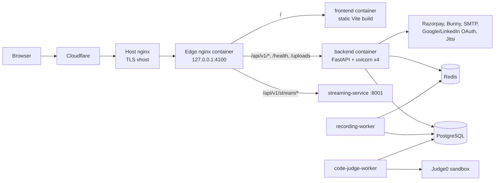

# SILEOS Knowledge Base

Living document for developers working on SILEOS (the SashaInfinity learning platform). Read this first, then the module sections you touch.

**Maintenance rule:** whenever a feature, bug fix, config change or architecture change lands, update the relevant section here in the same commit. Record the date of the change in the changelog at the bottom.

---

## 1. Project overview

SILEOS is a learning management system with several product areas on one codebase:

- **Learning:** courses, lessons, quizzes, assignments, progress, certificates, labs (browser labs, virtual labs, 3D models), coding challenges, live classes and recordings.
- **Commerce:** cart, checkout, coupons, bundles, memberships, Razorpay payments, invoices.
- **Company and career:** company dashboards, internships, candidate profiles.
- **Campus OS:** admissions, tuition and fee collection, exams, transport, hostel, staff, parent portal, WhatsApp and mail messaging.
- **Content:** Tamil-language category pages (Meiporul, Seyappaduporul, Utporul), blog, content libraries, Hall of Fame.
- **Admin and superadmin tools:** course studio, certificate designer, analytics, AI layer, gradebook.

Roles: Student, Instructor, Admin, Company, CompanyManager, plus superadmin.

### Technology stack

| Layer | Technology |
|---|---|
| Frontend | React 18, Vite 5, TypeScript, React Router 6, Zustand, TanStack Query, Axios, framer-motion, three.js 0.183 |
| Backend | Python, FastAPI 0.104, SQLAlchemy 2, Pydantic, uvicorn (4 workers in dev), Redis, Sentry |
| Database | PostgreSQL. Schema is created by `create_all` at backend startup; SQL files live in `backend/migrations/` |
| Queues and background work | `recording-worker` (runs background loops), `code-judge-worker` (Judge0 sandbox, opt-in profile `coding`) |
| Video | `streaming-service` (yt-dlp proxy on port 8001), Bunny CDN, Jitsi for live classes |
| Edge | Nginx reverse proxy, Cloudflare in front, Let's Encrypt certificates on the host |
| Deployment | Docker Compose; GitHub Actions self-hosted runner on the VPS |

---

## 2. Architecture

### 2.1 Runtime topology



Production nginx (`nginx/conf.d/default.production.conf`) routes `/api/v1/stream/` straight to the streaming service on port 8001. The dev edge (`nginx/conf.d/default.conf`, `nginx/conf.d.local/default.conf`) sends `/` to the frontend container on port 3000 and `/api/v1/` to the backend.

### 2.2 Request lifecycle

1. The browser loads the SPA from nginx. Hashed `/assets/*` files are cached long-term; `*.html` is not cached.
2. The SPA calls `/api/v1/...` through the Axios instance in `frontend/src/api/axios.ts`. It attaches the access token and refreshes it on 401.
3. nginx proxies to the backend. `main.py` runs security middleware (rate limits, security headers, request logging, optional IP allow-list), then CORS, then the router.
4. The router validates input with Pydantic schemas, authenticates through `core/security.py` and `routers/auth.py`, and calls a service in `services/`.
5. Services use SQLAlchemy sessions from `core/database.py` and Redis via `core/redis.py`.
6. Media: uploads go to `./uploads` (served at `/uploads`), certificates to `./certificates` (served at `/certificate-files`). Video goes through the streaming service or Bunny signed URLs.

### 2.3 Repository layout

```
sileos-dev/                     project root (this folder)
├── backend/
│   ├── app/
│   │   ├── main.py             REAL entry point; registers ~116 routers
│   │   ├── core/               config, database, redis, security, TOTP, uploads, middleware
│   │   ├── routers/            HTTP endpoints, one module per feature (~140 files)
│   │   ├── services/           business logic called by routers (~100 files)
│   │   ├── models/             SQLAlchemy models (~79 files)
│   │   ├── schemas/            Pydantic request and response models
│   │   ├── workers/            runtime.py (scheduler), recording_lessons.py
│   │   ├── api/v1/             certificate verification (public)
│   │   ├── migration/          legacy data migration helpers
│   │   └── seed_data*.py       demo data
│   ├── migrations/             hand-written SQL migrations
│   ├── alembic/                upstream reference only (not used at runtime)
│   ├── tests/                  pytest suite (~140 test files)
│   └── requirements*.txt
├── frontend/
│   ├── src/
│   │   ├── App.tsx             route table
│   │   ├── pages/              route-level components (admin/, instructor/, student/, company/, superadmin/, parent/, spoc/ …)
│   │   ├── components/         feature folders: auth/gateway, sympho, labs, campus, ui, layout …
│   │   ├── api/                one module per backend area, plus axios.ts
│   │   ├── store/              Zustand stores (auth, cart, course, quiz)
│   │   ├── hooks/ utils/ lib/ types/ config/ styles/
│   │   └── offline/            offline support
│   ├── public/                 static assets, models/ar/*.glb (3D models), vendor/
│   └── vite.config.js          Vite config is JavaScript, not TypeScript
├── streaming-service/          video_streaming.py: yt-dlp proxy with range requests
├── code-judge-worker/          worker.py: runs learner code through Judge0
├── nginx/                      nginx.conf, conf.d/, conf.d.local/ (dev edge)
├── deploy/                     CI/CD scripts, production compose, runner bootstrap
├── .github/workflows/deploy.yml
├── docker-compose.yml          base dev stack
├── docker-compose.override.yml auto-merged locally
├── docker-compose.server.yml   THIS VPS only: port fixes, worker count, frontend volume fix
├── docker-compose.{prod,production,security,staging,ids,backup}.yml
└── .env                        secrets (gitignored). Never commit.
```

---

## 3. Modules and responsibilities

### 3.1 Backend core (`backend/app/core/`)

| File | Responsibility |
|---|---|
| `config.py` | pydantic-settings configuration with security defaults. `config_broken.py` is dead code; ignore it. |
| `database.py`, `database_async.py`, `database_postgres.py` | Sync and async SQLAlchemy engines and sessions. |
| `redis.py`, `redis_full.py` | Redis client. Redis stores sessions, revocations and rate-limit counters. |
| `security.py`, `auth_security.py` | Password hashing, JWT creation and validation, lockout rules. |
| `security_middleware.py` | Rate limiting, IP allow-list, request logging, security headers. |
| `totp.py` | RFC 6238 TOTP helpers (`pyotp`). Enforcement lives in `routers/auth.py`. |
| `cors.py`, `cache_headers.py` | CORS policy and cache-control headers. |
| `secure_upload.py`, `csv_safety.py`, `input_validation.py` | Upload checks, CSV formula-injection protection, input sanitising. |
| `runtime_telemetry.py`, `error_reporting.py` | Telemetry and Sentry. |
| `course_types.py`, `business_verticals.py`, `course_links.py` | Course-type rules and vertical (Meiporul / Seyappaduporul / Utporul) helpers. |

### 3.2 Backend routers (`backend/app/routers/`)

Each module is one feature area and is mounted in `main.py`, normally under `/api/v1/<name>`. Frequently touched groups:

| Group | Modules |
|---|---|
| Identity | `auth`, `users`, `admin`, `superadmin`, `platform_tenants` |
| Learning | `courses`, `lessons`, `quizzes`, `assignments`, `progress`, `certificates`, `certificate_designer`, `gradebook`, `mastery`, `learning_planner`, `learning_signals`, `scorable_items`, `question_banks`, `exam_papers` |
| Video and live | `video`, `video_streaming`, `player`, `bunny`, `youtube_embed`, `embed`, `live_classes`, `live_class_*`, `recording_lessons`, `jitsi` services |
| Labs and 3D | `labs`, `lab_studio`, `virtual_labs`, `three_d`, `three_d_tasks`, `geogebra`, `h5p`, `coding_assessments`, `coding_judge_internal` |
| Commerce | `checkout`, `cart`-related in `orders`, `payments`, `payments_proxy`, `coupons`, `bundles`, `memberships`, `commercial`, `payouts`, `company_billing` |
| Company | `companies`, `company_dashboard`, `internships`, `candidate`, `cohorts` |
| Campus OS | `admissions`, `tuition`, `tuition_collection`, `tuition_reminders`, `campus_*` (exams, staff, transport, hostel, growth, pilot, operations, control plane), `parent_portal`, `parents`, `whatsapp` |
| Growth and engagement | `growth`, `funnel`, `flywheel`, `gamification`, `games`, `notifications`, `wishlist`, `hall_of_fame`, `blog` |
| Content | `library`, `content_library_admin`, `studio`, `curriculum_workspace`, `assessment_studio`, `uploads`, `chunked_upload` (mounted at `/upload/chunked`) |
| Ops | `observability` (private metrics), `operations`, `course_ops`, `export_import` |

Two mounts to remember: `chunked_upload` is not under `/api/v1`, and the WhatsApp webhook has its own nginx location.

### 3.3 Services (`backend/app/services/`)

Services hold business rules. Routers stay thin. Examples:

- `auth_service`: account rules, login flow support.
- `course_service`, `course_access`, `course_ops_service`, `course_package_service`: enrolment and access checks.
- `cart_checkout`, `coupon_service`, `fulfillment_service`, `invoice_service`, `invoice_pdf`: order-to-enrolment flow.
- `certificate_service`, `certificate_html_renderer`: certificate generation.
- `email_service`, `campus_mail`, `campus_whatsapp`: messaging.
- `lab_*_service`, `glb_budget`: 3D lab catalogue and model budget checks.
- `campus_*`, `growth_*`, `attendance_report`, `class_report_service`: Campus OS reporting and operations.
- `jitsi_token_service`: signed Jitsi tokens.
- `ai_layer_service`, `ai_provider_vault`: AI provider selection and key storage.

### 3.4 Models and schemas

- `models/` holds about 79 SQLAlchemy models. Key ones: `user`, `course`, `enrollment`, `payment`, `certificate`, `quiz`, `assignment`, `company`, `internship`, `candidate`, `cohort`, `page_view`.
- `schemas/` holds Pydantic request and response types. Keep them in step with the models.

### 3.5 Background workers

- **`recording-worker`** runs `python -m app.workers.recording_lessons` and the background loops (`BACKGROUND_TASK_MODE=worker`). Keeping loops out of the API workers stops them running once per uvicorn process.
- **`app/workers/runtime.py`** is a supervised maintenance scheduler. Redis picks the scheduler. Durable database claims and Postgres advisory locks are the safety boundary, so duplicate delivery is avoided at the database layer.
- **Judge0 sandbox** (`docker-compose.judge0.yml`, `judge0/judge0.conf`, gitignored): `judge0-server`, `judge0-workers`, `judge0-db`, `judge0-redis`. Internal network only, privileged. Runs on dev and is wired to `code-judge-worker`. Java is currently blocked; see `docs/CODING_PLATFORM_PLAN.md`, Phase 0.
- **`code-judge-worker`** leases Utporul coding submissions and runs each test case in a Judge0 sandbox with networking disabled. It never executes learner code itself. Enable with compose profile `coding`.

### 3.6 Streaming service (`streaming-service/video_streaming.py`)

- Standalone FastAPI app on port 8001.
- Resolves unlisted YouTube videos with `yt-dlp` and proxies the stream with HTTP range support.
- In-memory URL cache with a 10-minute TTL.
- Its own CORS is open (`*`) and it has no auth. **The backend must authorise the learner before a client is sent here.**
- Code is baked into its image; only the yt-dlp cache is mounted.

### 3.7 Frontend (`frontend/src/`)

- **Routing** (`App.tsx`): public pages (`/`, `/courses`, `/labs`, `/hall-of-fame`, `/bundles`, `/membership`), auth pages (`/login`, `/register`, `/verify-email`, `/forgot-password`, `/reset-password`), and role-based areas (`/dashboard`, `/admin/*`, `/instructor/*`, `/company/*`, `/parent/*`, `/superadmin/*`, `/spoc/*`).
- **API layer** (`api/`): one module per backend area, all using the shared `axios.ts`. Keep URL paths in these modules, not in components.
- **State** (`store/`): Zustand for auth, cart, course and quiz state. TanStack Query handles server data.
- **Auth gateway** (`components/auth/gateway/`): the sign-in and sign-up experience ("Infinity Gateway"). `auth-layout.tsx` wraps `/login` and `/register`, and `GatewayCanvas.tsx` draws the animated network behind them.
- **3D** (`components/sympho/`, `pages/meiporul-ar.tsx`): three.js scenes for the hero and the AR gallery. Models are GLB files in `frontend/public/models/ar/` and are meshopt-compressed for the gallery (decoder at `public/vendor/meshopt_decoder.js`).
- **Lesson practice** (`components/coding/LessonPracticeBlocks.tsx`, `LessonPracticeEditor.tsx`): instructors attach challenges to video lessons in the curriculum editor. **New challenge** in that section (`ChallengeCreator.tsx`) creates and publishes a challenge without leaving the course builder, then adds it as a practice row; the instructor still clicks **Save practice**. The lesson player pauses at a timed block and opens `CodingWorkspace`. Data in `lesson_coding_blocks`; learner drafts in `coding_drafts`. See `docs/CODING_PLATFORM_PLAN.md`, Phase 2.
- **Coding workspace editor** (`components/coding/`): Monaco, loaded lazily on `/coding/:slug`. `VITE_CODING_EDITOR=textarea` at build time restores the plain textarea. Error markers come from `errorLocations.ts`. See `docs/CODING_PLATFORM_PLAN.md`, Phase 1.
- **HTML and CSS challenges** (2026-11-27): `html` and `css` are coding languages, but they are not run by Judge0. The judge worker renders the page in headless Chromium (`code-judge-worker/web_check.py`) with page scripts off, the context offline and every request aborted, then reads the values each test asks for. Tests store a check as JSON in `input_text` (`{"kind": "text|css|exists|count|attr", "selector": "...", "property"/"attribute": ...}`) and the expected value in `expected_output`. Style checks compare after converting hex and named colours to `rgb()` (`backend/app/services/web_checks.py`). A CSS challenge keeps the page markup in `starter_code.html`; the claim payload sends it as `page_html`. HTML/CSS cannot be mixed with programming languages in one challenge. Learners get a live preview in a permission-less sandboxed iframe. The worker image is pinned to `python:3.12-slim-bookworm` (Playwright 1.48 does not support newer Debian) and is about 1.5 GB because of Chromium.
- **Coding analytics** (Phase 3): `backend/app/services/coding_analytics_service.py`. Ranking is score first, then total judge time, then peak memory, then submit time. Routes under `/api/v1/utporul/coding/`: `courses/{id}/metrics` (JSON), `courses/{id}/metrics.csv` (sanitised with `csv_safety`), `learner/progress`. The instructor report is `components/coding/InstructorReport.tsx` in Coding Studio. The learner progress panel is on `/coding`. Editors only; students get 403 on metrics. No schema change. Per-challenge tie-break weights and the certificate setting are not built yet. See `docs/CODING_PLATFORM_PLAN.md`, Phase 3.
- **Page guides** (`page-guides.ts`): contextual help. Auth pages are excluded on purpose.
- **Frontend is baked at build time.** `VITE_*` variables are read during `npm run build`, so changing them needs a rebuild.

---

## 4. Key business logic and concepts

### 4.1 Authentication and sessions

- **Access and refresh tokens:** JWTs. Access tokens are short-lived. The refresh flow is `POST /api/v1/auth/refresh`.
- **Shared session cookie:** `sf_ss` is set by `_set_shared_session` in `routers/auth.py` so the LMS and SILEOS can recognise the same user.
- **Revocation:** sessions are tracked in Redis. `revoke_all_user_sessions` runs on logout.
- **Logout** (`POST /api/v1/auth/logout`) does not require a valid access token. It always clears the shared cookie and revokes sessions. It identifies the user from the bearer token or from the refresh token in the body or cookie. Impersonation tokens do not revoke all sessions. Before this rule, a refresh could bring back a logged-out session.
- **Admin 2FA:** mandatory for admins. The secret is stored on `User.totp_secret`, with `User.totp_enabled` as the flag. `_federated_totp_gate` applies the check to Google and LinkedIn sign-ins too.
- **Lockout and rate limits:** governed by `MAX_LOGIN_ATTEMPTS`, `LOCKOUT_DURATION_MINUTES` and `RATE_LIMIT_*` in `.env`.
- **OAuth:** Google (`/api/v1/auth/google/...`) and LinkedIn (`/api/v1/auth/linkedin/...`). The LinkedIn redirect is hard-coded to the LMS host, so check it before using LinkedIn on SILEOS.

### 4.2 Enrolment and access

- Purchases, bundles and memberships create enrolments through `fulfillment_service` and `course_access`.
- Course access is checked on the server for every lesson and video request. Frontend checks are for display only.
- Certificates are issued when progress and assessment rules are met. Public verification is at `api/v1/certificate_verification.py`, and the verification endpoint requires a certificate hash.

### 4.3 Payments

- Razorpay handles checkout. Webhooks are verified with `RAZORPAY_WEBHOOK_SECRET`.
- Dev keys are placeholders, so checkout cannot be tested on the dev server.
- Invoices are generated as PDFs (`invoice_pdf.py`).

### 4.4 Video and content protection

- Bunny CDN serves signed URLs (`BUNNY_SIGNED_URL_TTL`).
- YouTube lessons go through the streaming service. The backend checks access before handing out the stream.
- Uploads are scanned and checked by `secure_upload.py` (`SCAN_UPLOADED_FILES`, `QUARANTINE_INFECTED_FILES`).

### 4.5 3D models and performance

- Each GLB must stay within the budget in `glb_budget.py`. Large models should be compressed with meshopt (gltf-transform).
- The hero scene caps device pixel ratio at 2 (1.25 in low-quality mode), and it starts only after the opening loader has been removed.
- Models in `public/models/ar/` are gitignored by `.gitignore`. Force-add them when committing.

### 4.6 Campus OS

- **Separate Campus administrators (2026-11-28).** Campus has its own sign-in, `/campus/login`, and its own platform role, `campus_admin`. LMS `admin` and `superadmin` have **no** Campus access: `CampusRoute` sends them back to their own dashboard, the backend `PLATFORM_ADMIN_ROLES` (`services/institution_service.py`) is `("campus_admin",)`, and the plan-request and billing-recovery endpoints answer 403 to them. Campus members (owner, admin, teacher, student) get in through their institution membership. Create a Campus admin with `backend/scripts/create_campus_admin.py` (email and password come from environment variables; it refuses to convert an LMS admin).
- Admissions, tuition and fee collection, exams, transport, hostel, staff leave and substitution, parent portal and messaging. Each has a `campus_*` router and service.
- Reminders are run by `tuition_reminders`. WhatsApp uses `whatsapp` and `campus_whatsapp`.

---

## 5. Setup

### 5.1 Local development (Docker, recommended)

```bash
cp .env.example .env          # then fill in real values
docker compose up -d
docker compose logs -f backend
```

Local ports: frontend `http://localhost:4000`, edge `http://localhost:4100`, backend `http://localhost:8100`, streaming `http://localhost:8101`, Postgres `127.0.0.1:15432`.

### 5.2 Frontend without Docker

```bash
cd frontend
npm ci
npm run dev        # Vite dev server
npm run build      # production bundle to dist/
npx --no-install vitest run
```

### 5.3 Backend without Docker

```bash
cd backend
pip install -r requirements.txt
pytest
```

### 5.4 Creating an admin

- `backend/create_admin.py` and `seed_admin.py` create admin users. `create_admin.sh` wraps them.
- The admin account needs 2FA enrolment on first login.
- **Never put admin passwords in documentation or commit them.** Keep credentials in `.env` or a password manager.

---

## 6. Deployment and maintenance

### 6.1 CI/CD

`.github/workflows/deploy.yml` runs on push to `main`:

```
quality (lint, pytest, shellcheck) → build (images, local) → deploy (blue-safe recreate) → verify (public URL)
```

- Runs on the self-hosted runner on the VPS. Pull requests run quality and build only.
- `workflow_dispatch` allows a manual deploy or rollback.

### 6.2 Git workflow

- Work on `development`. Push to GitHub with `git push origin development:main`.
- Commit identity: use the deploy author configured for this repo.
- Do not commit `docker-compose.server.yml`, `frontend/dist*` or `.env`.
- Git history and conventions for AI-assisted commits are in `CLAUDE.md` and `AGENTS.md`.

### 6.3 Deploying changes

| Change type | Command |
|---|---|
| Backend code | `docker compose restart backend` (code is bind-mounted) |
| Backend dependencies | `docker compose build backend && docker compose up -d backend` |
| Frontend | `docker compose build frontend && docker compose up -d --no-deps frontend && docker compose restart nginx` |
| Streaming service | rebuild its image, then `up -d` |
| Database schema | applied at backend startup via `create_all`; run SQL in `backend/migrations/` by hand when a change is not additive |

Restarting nginx after a frontend rebuild is needed because nginx caches container IP addresses.

### 6.4 Server-specific rules (this VPS)

- Production LMS containers share this host. `docker-compose.server.yml` strips ports 3100 and 8000 so the dev stack does not collide with them.
- `UVICORN_WORKERS` in `.env` sets the backend worker count (default 4).
- The old `frontend/dist.stale-sep26/` folder is quarantined. Do not restore it, because it once masked every frontend rebuild.
- Never run `build-production.sh` casually: it runs `docker system prune -f` on the whole host.

### 6.5 Backups

- Database dumps go to `database/backups/`.
- Restore guidance is in `RESTORE_GUIDE.md`.

### 6.6 Monitoring

- `/health` and `/health/ready` on the backend, `/health/version` for the deployed version.
- Sentry through `sentry-sdk` if configured.
- Private metrics at `/api/v1/internal/observability`.

---

## 7. Troubleshooting

| Symptom | Likely cause | Fix |
|---|---|---|
| Site shows old UI after a deploy | Frontend image not rebuilt, or stale `dist` folder mounted | Rebuild frontend, `up -d`, restart nginx. Confirm `frontend/dist` is not mounted. |
| API calls return 502 or 404 | Backend not up, or nginx holding an old container IP | `docker compose ps`, then `docker compose restart nginx`. |
| Backend code change has no effect | Container not restarted | `docker compose restart backend`. |
| Logout does not end session | Refresh token still valid, or sessions not revoked | Confirm `/auth/logout` returns 200 and Redis revocation keys exist. |
| Admin 2FA code rejected | Phone clock drift, or secret replaced | Enable automatic time on the phone and retry. If the secret is lost, an admin with DB access re-enrols the user. Never share codes. |
| Tokens invalid after restart | `SECRET_KEY` / `JWT_SECRET` left as placeholder (regenerated each boot) | Set real values in `.env`. |
| Video will not play | Streaming service down, or yt-dlp cache stale, or cookies expired | Check `streaming-service` health on 8101 and refresh `youtube_cookies.txt`. |
| 3D model missing in AR gallery | GLB not in `public/models/ar`, or meshopt decoder not loaded | Confirm the file exists and that `MESHOPT_DECODER_SRC` is set in `meiporul-ar.tsx`. |
| Payments fail on dev | Razorpay keys are placeholders | Expected on dev. Use test keys on a staging stack. |
| Email not sent | SMTP not configured or invalid | Check `SMTP_*` in `.env` and run `backend/check_smtp.py`. |
| Coding challenge never graded | `code-judge-worker` not running, or Judge0 down | `docker compose ps judge0-server code-judge-worker`. The worker runs by default on dev. |
| Coding submissions stay `queued` for a long time | Worker throttled by the general rate limit (1000 requests per hour) | `/api/v1/internal/coding/` is exempt in `security_middleware.py`. Check the worker log for `429`. |
| Instructor can't create a coding challenge; lesson practice box says to publish one first | Coding Studio had no menu link before 2026-11-27 | It is now under **Content Studio → Coding Studio** (`/instructor/coding-studio`). The lesson's Coding practice box now also has **New challenge**, which creates and publishes one in place. The box links to Coding Studio with `?course=<id>` and shows the real error if loading fails. The course must be type Utporul. |
| New backend routes return 404 on dev, or new tables are missing | The dev backend runs uvicorn with 4 workers and **no auto-reload**. The code is bind-mounted but not reloaded. | `docker compose restart backend` after backend changes. The frontend serves a built image, so after frontend changes run `docker compose build frontend && docker compose up -d --no-deps frontend && docker compose restart nginx`. |
| Live class stuck on "Connecting to class…", console says `Refused to frame 'https://liveclass.sashainfinity.com/'` | The Jitsi vhost (`/etc/nginx/sites-enabled/sashainfinity-liveclass.conf`, host nginx) only lets listed sites embed it (`frame-ancestors`). It was missing `sileos.sashainfinity.com` and `dev.sashainfinity.com`. | Add the page's origin to the `frame-ancestors` list in that file, `nginx -t`, `nginx -s reload`. Test from the real origin, not `localhost`, because `localhost` is never allowed. |
| Live class: `xmpp-websocket` returns 502, error log says `xmpp.meet.jitsi could not be resolved` | `jitsi-web`'s `/config/nginx/meet.conf` (bind mount `sasha_lms/deploy/jitsi/web/nginx/meet.conf`) pointed at `xmpp.meet.jitsi`, a name the stack does not define. The chat server is `prosody`. | Use `prosody:5280` for `/http-bind` and `/xmpp-websocket` in that file, then `docker exec sasha-jitsi-web nginx -t && docker exec sasha-jitsi-web nginx -s reload`. A graceful reload does not drop calls. |
| Live class: "The WebSocket connection could not be established or was disconnected" while `/xmpp-websocket` shows `limiting requests` in `/var/log/nginx/error.log` | The per-IP limit (`sasha_general`, 10 r/s, burst 20) from `snippets/sasha-ratelimit.conf` rejected the WebSocket in the burst of requests a Jitsi page load makes. | `sashainfinity-liveclass.conf` now exempts `/xmpp-websocket`, `/http-bind` and static assets from the per-IP request and connection limits and keeps a burst of 60 on everything else. Proxy settings live in `snippets/sasha-live-proxy.conf`, used only by that vhost. Do not edit the shared `sasha-ratelimit.conf` for this; other sites use it. |
| Pushing a live coding test, or a student submitting code, returns 403 from the public domain but works on `localhost:4100` | The host firewall (Coraza with OWASP CRS 4.25, in the Caddy on port 8082) matches code in request bodies. Rule 932370 "Windows command injection" fires on `print` at the start of a line, so a normal multi-line Python program is blocked; `console.log(5)` and `import os` are blocked too. | Find the rule in `/var/log/coraza/audit.log` (inside the Caddy's filesystem, `/proc/<caddy pid>/root/var/log/coraza/audit.log`; search the request URI, read `[id "…"]`). The coding endpoints need to be handled in detection-only mode like the existing `@richtext` handle in the Caddyfile. This changes a shared production security component, so it needs the owner's approval. Do not hide code from the firewall by encoding it. |
| Live class: "Recording unavailable", or recording never starts | Four separate causes were found. (1) Recorder `sasha-jitsi-jibri` must be running; it is no longer profile-gated, so `docker compose -p sasha-live -f compose.live.yml --env-file .env.live up -d` starts it with the stack. Run `bash e2e/live-class/healthcheck.sh` (about 2 s, read-only) to see which of these causes applies. (2) Host needs `snd_aloop` (persisted in `/etc/modules-load.d/snd_aloop.conf`), `/dev/snd` and `DISPLAY=:0` on the container (set in `compose.live.yml`). (3) Prosody must create the recorder login domain: `.env.live` needs `XMPP_HIDDEN_DOMAIN=recorder.meet.jitsi` (the image default `hidden.meet.jitsi` does not match the recorder; symptom is `no-auth-mech` in the recorder browser log `/config/logs/browser.0.txt`). (4) Jicofo must wait longer for the recorder: `jicofo.xmpp.client.reply-timeout = 60 seconds` in `deploy/jitsi/jicofo/custom-jicofo.conf` (symptom: "Jibri start request timed out" then "all Jibris were busy"). Starting takes 15-30 s. `POST /live/classes/{id}/recording/failed` resets a stuck "requested" status. Recordings are uploaded to the video CDN by the recording worker. |
| Students see "End meeting for all" in the call and can use moderator tools | Two things promote students. Prosody needs `token_affiliation` so the token `moderator` claim decides (`XMPP_MUC_MODULES=token_affiliation` in `.env.live`). And Jicofo's JWT authentication also promotes every logged-in user, so `deploy/jitsi/jicofo/custom-jicofo.conf` sets `jicofo.authentication.enabled = false` and `jicofo.conference.enable-auto-owner = false`. | Recreate prosody (`up -d --no-deps --force-recreate prosody`, always with `--env-file .env.live`) and restart jicofo when no class is live. Check by reading `APP.store.getState()['features/base/participants'].local.role` in a student call: it must not be `moderator`. |
| Instructor clicks End class and sees "Couldn't connect to the class: Cannot read properties of null (reading 'appendChild')" | `JitsiStage` removed its call container whenever an error was shown, so the error the video server reports while closing the room (and the Retry button) tried to attach a call to a missing element. | Fixed 2026-11-28: the container is always rendered and init is skipped if it is missing. Jitsi reports `conference.destroyed` ("The meeting has been terminated") when the instructor uses the call toolbar's **End meeting for all**; that now ends the class on the server and opens the report, and learners leave to the ended page. A call error first checks the class status. Fullscreen button added to the call toolbar. Tests in `JitsiStage.test.tsx`. |
| A class created for "now" or started late disappears from the instructor's and students' lists | The Upcoming list used the start time. | Fixed: Upcoming uses the scheduled end (`routers/live_classes.py`). |
| Students stay in the call after the instructor ends the class | Ending only changed the database. | Fixed: a student's call checks the class every 10 seconds and leaves, and End class also sends `endConference` to the room. |
| Live class: "Couldn't connect to the class — Invalid signature" | The backend signs the call token with `JITSI_JWT_APP_ID` and `JITSI_JWT_SECRET`, and the video server (`sasha-jitsi-prosody`, `AUTH_TYPE=jwt`) only accepts its own `JWT_APP_ID` and `JWT_APP_SECRET`. Dev had its own pair (`sashainfinity-dev`). | Dev's `.env` now uses the video server's pair (`sashainfinity` and its secret). Compare fingerprints instead of printing secrets: `sha256` of the value on both sides. `.env` is mode 600, so keep it that way. Recreate the backend with `docker compose up -d --no-deps backend`, because `restart` does not re-read `.env`. |
| Judge0 runs fail with `Internal Error … /box/script.py` | isolate cannot use cgroup v2 | Judge0 must use per-process limits (`ENABLE_PER_PROCESS_AND_THREAD_*=true` in `judge0/judge0.conf`). |
| Node or TypeScript run times out or aborts | Memory cap too low for Node's address space | The worker applies a 1 GB floor (`MIN_MEMORY_MB` in `code-judge-worker/worker.py`). |
| Java submissions fail with `pthread_create EAGAIN` | JVM exceeds Judge0 thread and address-space caps | Known blocker. Do not enable Java in challenges yet. |
| Tests fail on stale expectations | Tests out of date with UI or API changes | Update the test to the current behaviour, after checking the change is intended. |

Useful commands:

```bash
docker compose ps
docker compose logs --tail=200 backend
docker compose exec postgres psql -U "$DB_USER" "$DB_NAME"   # DB_USER / DB_NAME from .env
cd backend && pytest -q                                       # run tests on the host (pytest is not in the backend image)
```

---

## 8. Onboarding guide for new developers

1. **Read in this order:** this file, `CLAUDE.md` (conventions and traps), `AGENTS.md` (boundaries and gotchas), `DEV-README.md` (this server), `BUILD.md`.
2. **Get the stack running** using section 5.1. Confirm the homepage loads at the local edge.
3. **Learn the entry points:** `backend/app/main.py`, `frontend/src/App.tsx`, and the API modules in `frontend/src/api/`.
4. **Pick a small first task** such as a copy change or a test fix. Follow the path: router, service, model, schema, then API client, then page.
5. **Know the traps:**
   - Only `main.py` is the real backend entry. Ignore `main_*.py` variants and `config_broken.py`.
   - The frontend is baked at build time. Rebuild after `VITE_*` or UI changes.
   - Five compose files exist. Check which one applies before editing.
   - Do not commit secrets or `.env`.
6. **Test before pushing:** `pytest` for backend, `vitest` and `tsc --noEmit` for frontend.
7. **Update this file** if your change alters behaviour, setup or deployment.

---

## 9. Known gaps and open items

- The LinkedIn OAuth redirect is hard-coded to the LMS host.
- `apple-vision-pro.glb` is no longer used by the hero; the Meta Quest 3S model replaced it. Confirm before deleting.
- The Meta Quest 3S model has no licence recorded. Confirm usage rights before public launch.
- Razorpay, Bunny, Firebase, Edgyy and Jitsi credentials are placeholders on dev.
- Some older docs (`README.md`, `CLAUDE.md` router counts, the frontend port 3000 in the architecture diagram) describe earlier states. Trust the code and compose files first.
- **Firewall rule for code (drift risk).** Applied only inside the running firewall container (`incubaseos-coraza-1`, `/etc/caddy/Caddyfile`), inside the `sasha_waf` snippet before `SecRuleEngine On`: `SecRule REQUEST_URI "@rx ^/api/v1/(utporul/coding/|live/coding-challenges/|live/classes/[0-9]+/coding-challenges)" "id:1009001,phase:1,pass,nolog,chain"` then `SecRule REQUEST_URI "!@rx (\.\.|%2[eEfF]|%5[cC]|//|;)" "ctl:ruleEngine=DetectionOnly"`. The same rule was added on 2026-11-28 to the source `/opt/incubaseos/waf/Caddyfile` (backup `Caddyfile.bak-20261128-before-coding-rule`), so a rebuild keeps it. If code submissions return 403 again (CRS rule 932370), check that file still contains `id:1009001`.
- Several `.md` files at the root are historical release notes. Keep new documentation in this file, or in `docs/`.

---

## 10. Changelog

- **2026-11-28:** Campus given its own admin login. `/campus/login` and the `campus_admin` role added; LMS admin/superadmin blocked from `/institutions/*` (frontend `CampusRoute`, backend `PLATFORM_ADMIN_ROLES`). Also restored `Institution.tenant_id` on the model, whose removal made every institution workspace return 500. Tests: `test_institutions.py`, `test_campus_operations.py`, `campus-route.test.tsx`. Not yet committed or pushed.
- **2026-11-26:** Live coding platform plan added at `docs/CODING_PLATFORM_PLAN.md` (proposed, not started).
- **2026-11-26:** Lesson practice blocks and learner drafts added (Phase 2). Instructors set blocks in the curriculum editor; learners practise in the lesson player.
- **2026-11-26:** Coding workspace uses Monaco with error markers and a textarea fallback (Phase 1). Judge worker routes exempt from the general rate limit and blocked at the dev edge.
- **2026-11-26:** Judge0 sandbox added on dev for the coding worker (Phase 0): 5 of 6 languages pass end to end; Java blocked. Worker gained a Node memory floor.
- **2026-11-27:** Coding analytics built on dev (Phase 3): instructor metrics and CSV export in Coding Studio, learner progress on `/coding`. Backend tests in `tests/test_coding_analytics.py`; frontend formatting tests in `metricsFormat.test.ts`. Not yet committed or pushed.
- **2026-11-27:** Live class coding challenges built on dev (Phase 4): instructors push a published challenge into a live session, learners submit from the live view, and the instructor watches a results board. Backend: `models/coding_live.py`, `services/coding_live_service.py`, `routers/coding_live.py` under `/api/v1/live/`. Frontend: `components/live/LiveChallengePanel.tsx` (Coding tab in the instructor dock, panel under the stage on the student join page). Not yet committed or pushed.
- **2026-11-27:** Coding review built on dev (Phase 5 part A): line-anchored comments on submissions, learner review requests, and the instructor review queue in Coding Studio. Backend: `models/coding_review.py`, `services/coding_review_service.py`, `routers/coding_review.py` under `/api/v1/utporul/coding/`. Frontend: `components/coding/ReviewThread.tsx`, `ReviewQueuePanel.tsx`. Not yet committed or pushed.
- **2026-11-27:** Coding hardening built on dev (Phase 6): learners get 6 new submissions per minute (429 with `Retry-After`), and submissions return 503 when 500 judge jobs are waiting. The queue gauges are in `/metrics` (`sasha_coding_*`), from `services/coding_ops.py`. Limits are constants in `coding_assessment_service.py`. HTTP load test on dev with 100 learners: all accepted and judged, but the worker drains about 0.46 jobs per second (218 s for 100). That run used the pre-restart backend, so pacing and backpressure were not active. Rerun with limits active: 100 of 100 accepted, submit p95 1.99 s, drain 191 s. The worker judges one job at a time (single loop, one container on dev); add replicas to judge faster. 2026-11-27: Coding Studio added to the instructor menu and Code practice to the student menu. Dev backend restarted and frontend rebuilt so Phases 3 to 6 are live on dev.
- **2026-11-27:** Live classes on `sileos.sashainfinity.com` fixed. Three separate causes (see Troubleshooting): the Jitsi `frame-ancestors` list did not include the sileos and dev hosts, `jitsi-web` proxied to an unresolvable `xmpp.meet.jitsi`, and dev signed call tokens with a key the video server rejects. Changes were made outside this repo: the host nginx file `sashainfinity-liveclass.conf`, the Jitsi web config under `sasha_lms/deploy/jitsi/web/nginx/meet.conf`, and dev's git-ignored `.env`. Dev now shares the production Jitsi key (chosen by the owner), and `.env` was tightened from 644 to 600. Verified in a browser from the real origin for both instructor and learner. A fourth cause surfaced from a real browser: the live class vhost used the shared per-IP limit (10 requests per second, burst 20), and a Jitsi page load fires dozens of requests, so the signalling WebSocket itself was answered 429 ("The WebSocket connection could not be established or was disconnected"). Fixed in the live class vhost only (see Troubleshooting). Known gap: the shared limit still applies to the LMS site's own vhosts (`sashainfinity-sileos.conf` and others), where two sessions from one IP loading the app at once got 429 on API calls and JS files. A classroom behind one network address may hit that. It is a site-wide protection choice, so it was not changed.
- **2026-11-28:** Live class workflow test finished: **26 of 26 steps pass** (`e2e/live-class/`, report `docs/LIVE_CLASS_TEST_REPORT.md`). Recording now works (recorder login domain, Jicofo reply timeout 60 s, `snd_aloop` persisted, healthcheck fixed), students are no longer moderators (Jicofo override file), and live coding works through the firewall (detection-only rule for coding routes, applied to the running firewall container only; `/opt/incubaseos/waf/Caddyfile` source not edited, so a rebuild of that project would lose it). Earlier fixes on 2026-11-27: late classes vanishing, students staying in the call after end, ended classes offering Join, dock clipping, misleading recording status.
- **2026-11-28:** Fixed the "Couldn't connect to the class (appendChild)" screen after the instructor clicks End class; Retry on that panel now works. Recorder is no longer profile-gated; added `e2e/live-class/healthcheck.sh`; firewall rule 1009001 also added to `/opt/incubaseos/waf/Caddyfile`.
- **2026-11-27:** Coding pair rooms built on dev (Phase 5 part B): shared Monaco editor over a FastAPI WebSocket. Relay is across workers through Redis pub/sub channel `coding:collab:{room}`. Backend: `models/coding_collab.py`, `services/collab_hub.py`, `services/coding_collab_service.py`, `routers/coding_collab.py`. Frontend: `components/coding/CollabEditor.tsx`, `PairPanel.tsx`, `collabFrames.ts`. Dev nginx edge has a WebSocket location for `/api/v1/utporul/coding/collab-rooms/`. The live production edge is `deploy/nginx/conf.d/10-app.conf` (blue/green), and it has the same WebSocket location; `deploy.sh` validates it with `nginx -t` and reloads it. The location was also added to `nginx/conf.d/default.conf` in the SILEOS server blocks, but the blue/green deploy does not use that file. The host TLS proxy in front of the edge must also forward WebSocket upgrades (not checked; it runs on the production server). Two-browser test on dev passed 8 of 8 (2026-11-27). Note for browser tests: a new learner account gets an "Add your mobile number" prompt until `user_profiles.phone` is set.
- **2026-11-26:** First version of this knowledge base, written from the repository layout, compose files, routers, services, nginx configs and CI workflow.
- **2026-10-30:** Infinity Gateway sign-in and sign-up redesign; logout now fully revokes sessions; hero swapped to Meta Quest 3S; gallery models compressed (meshopt); opening loader smoothed; page-header blueprints redesigned.
- **2026-10-29:** Backend moved to 4 uvicorn workers without reload (performance fix); frontend stale-build volume fixed.
- **2026-10-19:** Dev stack moved out of the LMS tree; `docker-compose.server.yml` added.
